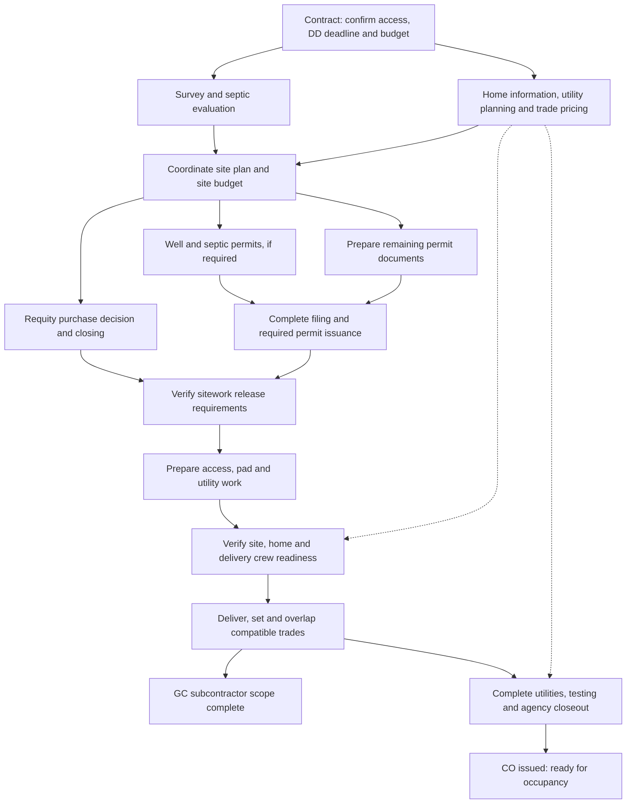

# High-level scheduling view

Adapt to actual applicability. Arrows express dependencies, not durations. Home procurement and utility planning continue on parallel paths with their own later release checks.

State separately: preclosing filing depends on office acceptance; sitework requires applicable ownership/authority, permits and commencement documentation; well/septic installation order depends on access; closeout coordination starts early. GC completion and CO are separate milestones and can have different dates.
